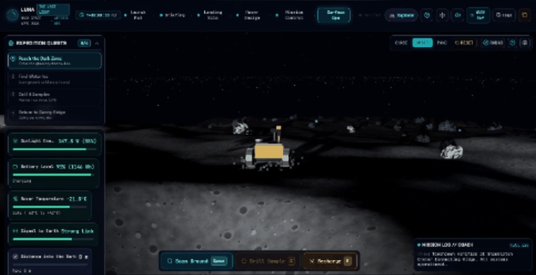

# 🌕 LUNA: The Last Light

### An Interactive Lunar Exploration Simulation

Explore the Moon. Make critical decisions. Complete your mission.

LUNA: The Last Light is an interactive lunar exploration game where players experience the challenges of planning and exploring the Moon. Navigate lunar terrain, manage mission resources, avoid hazards, and discover the science behind lunar exploration.

---

## 🎮 Gameplay Demo



*Watch LUNA in action and experience the lunar exploration mission.*

---

## 🚀 About the Project

LUNA transforms lunar exploration into an interactive gaming experience. Players take the role of mission planners and explorers, making decisions that influence their mission's progress and success.

Inspired by real lunar exploration missions and NASA science, LUNA combines 3D terrain visualization, exploration challenges, and resource management to make space science more accessible and engaging.

## ✨ Features

- **3D Lunar Environment** — Explore an immersive Moon surface.
- **Mission Planning** — Review objectives and prepare for lunar exploration.
- **Landing Site Selection** — Evaluate potential landing locations.
- **Rover Exploration** — Navigate the lunar surface and explore your surroundings.
- **Terrain Challenges** — Encounter craters, slopes, and obstacles.
- **Resource Management** — Make decisions using limited mission resources.
- **Scientific Exploration** — Discover concepts related to lunar science and exploration.

## 🕹️ How to Play

Your mission is to explore the lunar surface and complete your assigned objectives.

### Step 1 — Start Your Mission
Launch LUNA and enter the mission briefing to understand your objectives.

### Step 2 — Select Your Landing Site
Review the available landing locations and choose a suitable site based on the terrain and potential hazards.

### Step 3 — Explore the Moon
Control your rover and navigate across the lunar surface. Observe your surroundings and avoid obstacles.

### Step 4 — Manage Your Resources
Keep track of your available resources and make careful decisions throughout the mission.

### Step 5 — Complete Your Objectives
Explore the assigned locations, complete mission tasks, and review your final mission results.

### Controls

| Action | Control |
|---|---|
| Move forward | `W` or `↑ Arrow` |
| Move backward | `S` or `↓ Arrow` |
| Move left | `A` or `← Arrow` |
| Move right | `D` or `→ Arrow` |
| Camera control | Left Mouse Drag (Orbit) · Right Mouse Drag (Pan) · Scroll Wheel (Zoom) |
| Interact / Select | `E` or `R` (TRIDENT Drill) · `Spacebar` (Scan Regolith NSS) · Left Click |
| Pause / Menu | `Esc` (Settings / Help / Emergency Menu) · Top Nav (`NASA Ref`, `Logs`) |
| Speed Boost / Sprint | `Shift` (Dash Mode) |
| Camera Perspective | `V` (Toggle 2D / 3D Perspective) |

*Refer to the in-game instructions for the complete controls.*

## 🛰️ NASA Data & Science

LUNA uses NASA resources and lunar science to support its exploration experience.

NASA data and scientific references help inform the game's representation of the lunar environment and exploration challenges.

See the resources below for the datasets and references used in the project:

| NASA Resource | How It Is Used |
|---|---|
| [NASA LRO LOLA (Lunar Orbiter Laser Altimeter)](https://lunar.gsfc.nasa.gov/lola/) | Provides digital elevation models (DEMs), slope hazard profiles, and crater depth contours for south polar candidate landing sites (Shackleton Crater, Malapert Mountain, Haworth Depression) and calibrates the 3D procedural terrain mesh. |
| [NASA LRO Diviner Lunar Radiometer Experiment](https://diviner.ucla.edu/) | Provides surface and subsurface thermal data; calibrates the thermal physics model where temperatures drop to 25 K – 40 K (-248°C to -233°C) in shadowed crater floors vs. ~220 K (-53°C) on illuminated rims. |
| [NASA ShadowCam / KPLO (Danuri)](https://shadowcam.sese.asu.edu/) | Ultra-sensitive optical imaging of Permanently Shadowed Regions (PSRs) using secondary reflected light; guides visual contrast, regolith albedo, and micro-boulder distribution inside pitch-black cold traps. |
| [NASA LRO LROC Narrow Angle Camera (NAC)](https://www.lroc.asu.edu/) | High-resolution (0.5 m/pixel) targeted surface imagery providing geomorphology, traversability corridors, and boulder field distributions for polar landing locations. |
| [NASA VIPER Science Payload Suite](https://science.nasa.gov/mission/viper/) | Models the rover's scientific prospecting hardware: Neutron Spectrometer System (NSS), Near-Infrared Volatiles Spectrometer System (NIRVSS), and the 1-meter rotary-percussive TRIDENT drill. |
| [NASA Moon Trek & Planetary Data System (PDS)](https://trek.nasa.gov/moon/) | Archival planetary GIS repository providing polar cartography, georeferenced landing site coordinates, and South Pole-Aitken (SPA) basin boundary data. |
| [LOLA Solar Illumination Simulations (Mazarico et al., 2011)](https://doi.org/10.1016/j.icarus.2010.10.030) | Published LOLA horizon sun-visibility models enforcing the physical rule that direct solar irradiance is strictly 0.0 W inside geometric cold traps due to the Moon's 1.54° axial tilt. |

*Only list datasets and resources that are actually used in the project.*

## 🛠️ Built With

- **JavaScript** — Game logic and functionality
- **React** — User interface
- **Vite** — Development and build tooling
- **Three.js** — 3D lunar environment and visualization
- **Git & GitHub** — Version control and collaboration

## 💻 Getting Started

### Prerequisites

- Node.js
- npm
- Git

### Installation

1. Clone the repository:

   ```bash
   git clone https://github.com/nadd88/LUNA.git
   ```

2. Navigate to the project directory:

   ```bash
   cd LUNA
   ```

3. Install dependencies:

   ```bash
   npm install
   ```

4. Start the development server:

   ```bash
   npm run dev
   ```

5. Open the local URL displayed in your terminal.

## 🎯 Our Goal

We aim to make lunar exploration more accessible through interactive gameplay, encouraging curiosity about space science, critical thinking, and interest in STEM.

**Exploration begins with curiosity. The next step is yours.**

---

## 👩‍🚀 Team

Developed by Team LUNA for the NASA Space Apps Challenge.

## 📄 License

This project is licensed under the [MIT License](LICENSE) — open-source and educational for the NASA Space Apps Challenge.
